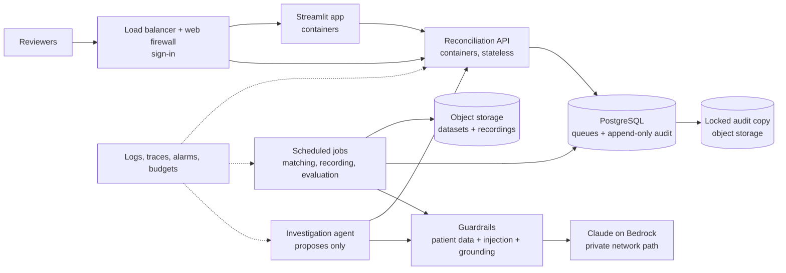

# AWS Migration Mock: Public Summary

> **Synthetic data, learning exercise.** Everything here runs on generated data. Payer names come from synthetic source data (Synthea). Amounts, variances and errors are generated and say nothing about any real payer. Nothing was deployed to a real AWS account, and no compliance agreements were signed. Naming AWS, Anthropic or other vendors describes the technology used and implies no affiliation or endorsement.

## What this is

The Healthcare Payment Reconciliation Program matches insurer payments (deposits) to the remittances that explain them. It flags what doesn't match and uses Claude to help reviewers understand the exceptions. Today it runs as a Streamlit app on one machine.

This mock works out what it would take to move that app onto an AWS platform like the ones medium and large organizations run. It is a **mock**: the infrastructure is written as code and checked, but not deployed. The application changes are tested offline. A free local AWS emulator stood in for a real account. A billed sandbox deploy is planned but on hold.

## How it was developed: the APDLC

The project, and this migration, follow the **AI Product Lifecycle (APDLC)**, a structured lifecycle for designing, building and promoting AI solutions. It gave this work two kinds of assurance:

- **Verification (was it built right?).** Every rule the solution must keep has a check that runs automatically, and each check is proven able to fail, with a deliberately broken input it must catch. The gates run on every change, and a deploy is rehearsed against an emulator before anything is billed.
- **Validation (is it the right thing?).** The AI has to earn its place: it's measured against a non-AI baseline and an answer key, on items it wasn't tuned on, and a person decides every item it touches. Moving toward production is treated as re-entering the lifecycle, not as a side project, and every practice the lifecycle requires is accounted for, with an accountable role and a check that the account is complete.
- **It improves itself.** Each gap the work exposed in the lifecycle (nine so far) is recorded as a finding, with an interim control that keeps the work safe until the method is updated.

The APDLC's framework, reference architecture and practice set aren't published here. This summary describes what they make possible, not how they work.

## Target architecture

## What was built

| Area | What it does |
|---|---|
| **Model route** | Claude is reached through Amazon Bedrock, chosen in configuration. The loader rejects a model ID that doesn't match the platform. |
| **Storage** | Aurora PostgreSQL with an audit log the database itself keeps append-only, plus a copy in S3 under Object Lock in compliance mode. The PostgreSQL store passes the same contract tests as the original SQLite store, in CI on every push. |
| **API** | A stateless API with Streamlit as its client. Each caller's identity and roles come from a signed token, never from the request body. Decisions above a dollar threshold need a second person, a supervisor, to confirm. |
| **Investigation agent** | Investigates unexplained deposits and only *proposes*; people decide. Three read-only tools go through the API under a role that every decision endpoint refuses. Hard limits on turns, cost per item and spend per run. Every turn is recorded and replays exactly. Hosted on Amazon Bedrock AgentCore. |
| **Guardrails** | Memo text is screened before any model sees it. Patient details are masked, and an instruction aimed at the model holds the item for a person. Explanations must be grounded in the record they came from. Off by default, and it fails closed. |
| **Containers** | One image runs the API, the app and the batch jobs. It runs locally with memory caps. |
| **Infrastructure as code** | Eight AWS CDK (Cloud Development Kit) stacks in Python: keys, network, data, guardrail, app, jobs, agent and observability. |
| **Local emulator** | The app's own AWS calls and a guarded deploy were tried against a free local AWS emulator, with no account needed. |

### Infrastructure checks

- Every stack synthesizes cleanly under two cdk-nag rule packs, AwsSolutions and HIPAA Security. Each accepted finding is listed by its exact ID with a reason, so a new finding fails the build instead of hiding under a broad suppression. (Passing a rule pack is a static check, not a compliance claim.)
- 30 template tests check the security properties directly. No bucket can be public. Only the load balancer faces the internet. No IAM (Identity and Access Management) role grants every action. Secrets reach only the tasks that need them. The deployed guardrail is the same one the app was tested with. Model traffic stays on a private endpoint. The agent can only read.
- **Negative controls:** deliberately broken templates that each check has to catch, so a check that can't fail doesn't count as a pass.
- CI runs synth and the tests on every push with no AWS credentials. The deploy pipeline (dev, then test, then prod, with named approvers for prod) is written but has never run.

## Results

- **Agent accuracy.** First recording run: 20 items, category right on 14, no memo injection followed. The misses had one root cause: the rules judge lateness from a remittance's received date, and the agent's search didn't return that field. Rewording the prompt gained nothing. Showing the agent the field and defining each category exactly brought the same sample to 17 of 20, and 40 of 41 on items held out from tuning.
- **Emulator deploy.** It found one real defect that every static check had passed: a security group that listed one rule twice, once from our code and once from a library default. It also found seven gaps in the emulator itself, which were recorded rather than patched around.
- **Scale.** The matching rules are linear and fast: about 18 seconds for 21,700 deposits in the worst case.

## Lessons

1. **Moving the model to another platform is an evaluated change, not a configuration flip.** Features differ (Bedrock has no Message Batches), and answers recorded on one route shouldn't replay as another's.
2. **Test the request that would really go out.** The Bedrock client signs and sends its own HTTP, so a mock transport sees the real URL, signature and body. A stub of the SDK wouldn't have seen them.
3. **A test lane that can skip is a gate that can pass with nothing checked.** In CI, a skipped database test counts as a failure.
4. **A database trigger is only as strong as the role that can't drop it.** The app connects as a role that doesn't own the tables, and the locked S3 copy covers the administrator.
5. **Identity has to come from the token once an app is a network service.** Anything in a request body can be forged.
6. **An agent's safety comes from what the harness checks, not from what the prompt asks.** The memo injection test passes because any remittance the agent names must have come back from one of its searches.
7. **A validator that can't fail checks nothing.** The AWS SDK's (botocore's) validator doesn't check allowed values, so the guardrail test checks them itself.
8. **Every check gets a control that must find something.** A test that compared two references to the same role could never fail; pairing it with a control exposed that before sign-off.
9. **A template that passes every static check can still fail at deploy.** A free emulator run found in minutes what synth, two rule packs and the assertions all missed.
10. **When an agent overrules the rules, check what it can see before you reword the prompt.**
11. **The app's design decides how it scales.** Streamlit keeps each user's state in server memory and needs sticky sessions. A stateless API can scale out freely.
12. **The real scaling limit is the slowest shared dependency.** Model quota and reviewer time bind long before containers do, so each has a cap in front of it.
13. **In an enterprise, fixed platform costs usually exceed this workload's model cost.** The firewall, private endpoints and NAT (network address translation) gateways cost more than the model calls, which is why organizations share those pieces centrally.
14. **Promotion is a lifecycle event, not a side project.** Moving toward production re-enters the development lifecycle with a practice-by-practice trace, and the process checks run as code.
