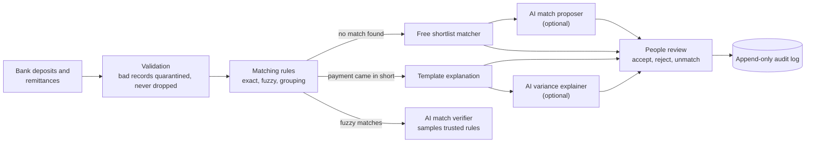

# Healthcare Payment Reconciliation Program: Public Summary

> **Synthetic data, learning exercise.** Everything here runs on generated data, with no real users and no real patient data. Payer names come from synthetic source data (Synthea). Amounts, variances and errors are generated and say nothing about any real payer. The project is built from public concepts and makes no claim of payments or healthcare-operations expertise. Naming Anthropic, Streamlit or other vendors describes the technology used and implies no affiliation or endorsement.

**Live demo (replay only, synthetic data):** https://hcpayreconcile.streamlit.app

## The problem

When an insurer pays a provider, the money and the explanation travel separately. The money arrives as a bank deposit (an EFT, electronic funds transfer). The explanation arrives as a remittance advice (an 835-style ERA, electronic remittance advice) that lists the claims paid and any adjustments. Someone has to match each deposit to its remittance, find what doesn't match, and work out why a payment came in short.

This project reconciles synthetic deposits against synthetic remittances. It asks one question throughout: **which parts of this work are worth automating, and where does AI earn its place?**

## How it works

**Coded rules do most of the matching, people review everything the rules aren't trusted to decide, and a rule earns the right to decide on its own only by proving its accuracy, with an AI verifier helping people check that it stays accurate.**

Reading the diagram from left to right:

1. **Check the records.** A record with missing or malformed fields isn't thrown away. It goes to a queue with the reasons it failed, so a person can fix it.
2. **Match with rules.** Plain rules match most deposits, with no AI and no cost per item:
   - **Exact:** the reference (trace) number and amount match one remittance.
   - **Near miss:** for example, a trace number with one mistyped character, or the only remittance from that payer for that amount.
   - **Grouping:** one deposit pays several remittances, or several deposits add up to one.

   A deposit is compared only with remittances from the same payer, received within a few business days, which keeps matching fast and avoids false matches.
3. **Short-list the rest.** For each deposit the rules couldn't match, a free matcher lists the likely remittances. A person works from that list, and an AI model can optionally propose one.
4. **Explain short payments.** When a payment comes in below what the remittance says, a template explains the gap from its adjustment codes. An AI model can optionally write the explanation instead.
5. **People decide.** A person reviews every match that isn't exact and every AI suggestion, and gives a reason. Items over $5,000 need a second person. Planted test items with known answers check that reviewers aren't approving on autopilot. The system never moves money.
6. **Record everything.** Every decision goes into an audit log that can only be added to, never edited.

**Earning trust.** A near-miss rule can skip review once its track record proves a low error rate, using the statistical sampling manufacturing uses to accept a batch. An AI verifier then spot-checks its matches and flags suspect ones for a person; a single mistake the person confirms puts the rule back under review. This spares people from hand-checking trusted rules: they review only what the verifier flags, almost nothing while a rule is healthy, a handful once it drifts. The verifier helps keep trust honest; it never grants it.

**Where AI is used.** Three narrow steps: proposing a match, explaining a short payment and spot-checking trusted rules. None can take actions or call tools. Each only suggests or flags, and a person or plain code decides.

## Design principles in the code

- **Money is integer cents,** never a floating-point number.
- **No record is ever dropped.** Anything that fails validation is quarantined with its reasons and shown in a queue.
- **The model sees payment-level fields only:** never patient IDs, service dates or names. Memo text is passed in as untrusted data, so an instruction planted in a memo is treated as content, not as a command.
- **Model output is checked before anyone sees it.** An explanation that states an amount not in the record is stopped. A circuit breaker and a spend cap stop runaway calls.
- **Decision logic is plain code the app can't bypass.** The database itself enforces the audit log's append-only rule and blocks double-posting.
- **Nothing tunable is hard-coded.** Model IDs, thresholds, tolerances, sample sizes and the spend cap all live in one settings file.
- **Illustrative adjustment codes.** The industry's standard reason-code lists are copyrighted with no stated terms for a public demo, so the project uses its own codes. A production version would map to the licensed lists.

## The app

A Streamlit app walks through a reconciliation period: run, results, the review queue, exceptions, variances, matches, a root-cause view and the audit trail. An Analogue Cost Model page (below) lets you change a cost assumption and see each step's break-even move, and which assumption decides whether it pays. Its costs are illustrative.

The app replays recorded model outputs, so it needs no API key and costs nothing to run or share. The tests replay the same recordings, so CI makes no API calls.

## The Analogue Cost Model

Before anything was evaluated, a simple cost model asked whether each automated step could pay for itself. It weighs what a step costs (model calls, the checks that keep it safe) against what it saves (reviewer time), and the cost of the mistakes it lets through.

Its inputs are plain operating figures: the cost of one review, the cost of finding a match by hand, the cost of one misposting, the model's price per item, and how many items a period brings. Every figure is an illustrative assumption here; a real version would use measured costs.

**Break-evens replace arbitrary targets.** Each AI step, and each rule allowed to skip review, gets a formula for when it pays for itself. The evaluation thresholds come from those formulas and were fixed before the run. With the illustrative figures:

- The **match proposer** pays for itself if its extra right matches save more hand-searching than it costs: about 1 extra match in 417 unmatched deposits.
- A **fuzzy rule** may skip review while its wrong-match rate stays below the point where mistakes cost more than the reviews it saves: 0.62%. That's the threshold the rule-accuracy check below proved.

The cost model also makes two things explicit:

- **Freed time saves nothing until someone decides its use.** It can be reinvested where people are now the bottleneck (exceptions, recovery, evaluation), absorb growth without hiring, or be removed as cost. A rule that frees hours nobody uses adds control costs and risk for no return.
- **Some things are never traded against cost.** Never posting money, never auto-accepting a model proposal, never dropping a record, and the injection and fabrication controls are fixed constraints, not inputs to a break-even.

## How it was evaluated

The evaluation plan was **fixed before the test data existed**, then run once on fresh data that nobody had seen.

- **Every gate was shown to fail.** Each check has a planted defect it must catch (for example, a rule that ignores ambiguity, or a proposer that follows memo instructions) and a correct stand-in it must pass.
- **Sample sizes were set from the claim.** Each test set is large enough to prove its threshold statistically, not just to have "enough" cases.
- **Three trials, all must pass.** A model step passes a gate only if it holds in every trial.
- **AI had to beat a free baseline** by a margin set from its break-even, or be switched off.

### The three AI experiments

| AI experiment | Hypothesis | Up against | Outcome | Verdict |
|---|---|---|---|---|
| **Match proposer** | AI finds right matches for leftover deposits often enough to pay for itself (about 1 extra in 417) | The free shortlist matcher, on the same leftovers | 0 extra matches in 259; no wrong proposals | ❌ Switched off: same result, added cost |
| **Variance explainer** | AI explains short payments as accurately as the template, and more clearly | The fill-in-the-blanks template | Read more clearly, but every model sometimes wrote an amount wrong, usually cents as dollars ($55,112 for $551.12). All were stopped before a person saw them; the template never erred | ❌ Switched off; template stays |
| **Verifier** | AI catches enough of a trusted rule's wrong matches (at least 28%), without false alarms, to replace manual audits | About 99 random hand checks per rule each period | At least 31% caught, no false flags; a 3% drift caught within a period 96% of the time | ✅ Kept |

### Rules, safety and robustness

| Check | Result | Plain reading |
|---|---|---|
| Rule accuracy | ✅ | Each fuzzy rule made over 1,000 matches with no wrong ones, enough to show its error rate is below the point where a mistake costs more than a review saves. |
| Resists manipulation | ✅ | The AI proposer followed none of 62 instructions planted in memo text, including 22 where the instruction was the memo's only clue. |
| Steady answers | ✅ | Changing something irrelevant (order, spacing, a stray phrase) changed at most 1 answer in about 260. |
| Bookkeeping, safeguards, cost, scale | ✅ | Logic that never varies is proved by tests, which pass. |

### Decision

- **Keep** the matching rules and the template explanation as the reconciliation path.
- **Earned autonomy for the fuzzy rules:** eligible on synthetic evidence, but not granted for real use until a shadow-mode trial on real payments, with a named approver, confirms it.
- **Keep** the AI verifier as the monitor for trusted rules. It saves review time in both states of a trusted rule. While the rule is healthy, people review almost nothing, instead of hand-checking about 99 random matches each period. When the rule starts to drift, the verifier flags its mistakes early, and people confirm a handful of flagged items rather than search a random sample for them. A drift smaller than 3% isn't guaranteed to be caught within a period. A person still confirms every flag.
- **Switch off** the AI match proposer and the AI explainer. They stay built, so they can be switched back on if real data shows they help.

AI earned one role here: watching trusted rules. For the other steps, the verdict is "not proven yet", not "never". The synthetic data has clean memos and one cause per short payment. Real remittances compound causes and real memos are free text, which is where a model could earn its place.

## Lessons

1. **Deterministic first won.** Rules, the free matcher, the template and a reconciliation table beat the model steps. AI-assisted development makes tailored deterministic code cheap to build, so code with proven user benefit is often the better choice than a model call at runtime.
2. **A gate has to be able to prove its claim.** 18 correct out of 20 can't prove 90% accuracy. The first gates were set before anyone checked whether they could be proven, and had to be reworked before evaluation.
3. **Check that the data can show the signal before you spend.** Clean synthetic memos left little room for an AI step to show value. Synthetic data needs deliberate headroom: compound causes and messier text.
4. **Pilot before any significant billed run.** A small sample replayed through the full grader would have exposed a grading-rule mismatch and a verifier hitting its output-token cap before the full spend.
5. **A check that can't fail checks nothing.** Every gate got a planted defect, and code reviews caught gates that could pass for the wrong reason.
6. **Write the detail first, then the summary.** A summary written first can steer readers away from the messy parts where an oversight hides.
7. **Show effects in the units they move in** (dollars a period, hours), so small changes aren't rounded away.
8. **A replay-only demo is safe to share.** Recorded model outputs mean no API key in the app and no spend in CI.

## Technology

Python, managed with uv · Pydantic for the canonical records · SQLite store · Streamlit · Anthropic Python SDK, with Message Batches for evaluation · pytest, ruff and pyright · GitHub Actions CI · Synthea for the synthetic source data
